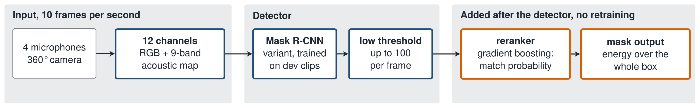

# Audiovisual Sound Event Localization

For the DCASE 2026 Challenge, Task 3, audiovisual track, the system uses four microphones and a 360-degree camera to find which of 13 sound classes are active and where each one is on the panorama, 10 times per second. The system took 3rd place in the ranking and had the highest AP75 of all 15 systems in the official evaluation. Research internship at the KIST AI and Robotics Institute, Humanoid Research Center (2026).



## Ranking was the problem

With no confidence threshold, the official baseline's detector already finds 71% of the events (IoU 0.25), while its mAP is 0.0003. This points to the ranking. So the detector keeps up to 100 candidates per frame, with scores as low as 0.01 (`ranking/dump_detections.py`).

## Rerank by match probability

A gradient-boosting model reads 16 features of each candidate (detector score, box geometry, co-detections, energy-map statistics) and predicts whether it will match a reference event. That probability replaces the detector's score (`ranking/rerank.py`).

## Nine points per box

The reference field is dense, so each kept box is written as a mask instead of a single peak: its 28 x 28 energy map sampled on a 3 x 3 grid inside the box, nine points with position and intensity. The soft IoU with the reference rises from 0.27 to 0.84. The 3 x 3 grid gives the overlap of a denser grid and keeps every result file under the 20 MB submission limit.

## Results

On the development set, mask output and reranking raised the system mAP from 0.0013 to 0.021 without retraining the detector. The final mAP was 70 times the official baseline's. In the official evaluation, the system had the highest AP75 of all 15 systems (0.0009) and took 3rd place in the ranking.

## Run

The code builds on the official baseline repository. Set `BASELINE_DIR` to it and `DCASE_LABELS` to the development labels.

```sh
python detector/train.py            # detector on the dev clips
python ranking/dump_detections.py CHECKPOINT N_CLIPS
python ranking/rerank.py TAG
```
